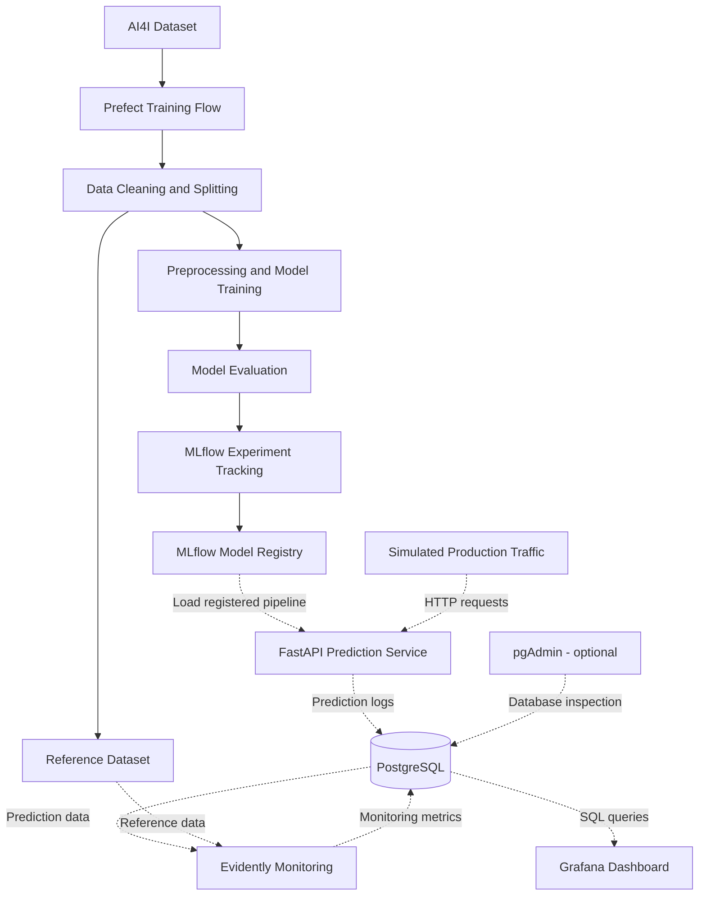

# AI4I Predictive Maintenance — MLOps Pipeline

INSY 684 | McGill University

## Overview

This project builds an end-to-end MLOps system for machine failure prediction using the AI4I 2020 Predictive Maintenance dataset. The system is designed to support reproducible model training, experiment tracking, model registration, prediction serving, and production monitoring.

The current implementation includes data preparation, model development, MLflow experiment tracking and registration, Prefect training orchestration, and PostgreSQL database integration. Model serving and monitoring are subsequent development stages.

## Business Problem

Unexpected machine failures can cause production downtime and maintenance costs. The project aims to identify potentially failing equipment using operational measurements, supporting proactive maintenance decisions. The dataset is synthetic, so the project demonstrates technical feasibility rather than validated performance in a real industrial setting.

## Dataset

Source: [UCI AI4I 2020 Predictive Maintenance Dataset](https://archive.ics.uci.edu/dataset/601/ai4i+2020+predictive+maintenance+dataset).

| Feature | Description |
|---|---|
| Type | Product quality category (L, M, H) |
| Air temperature [K] | Ambient temperature |
| Process temperature [K] | Process temperature |
| Rotational speed [rpm] | Rotational speed |
| Torque [Nm] | Applied torque |
| Tool wear [min] | Tool usage duration |
| Machine failure | Binary target: 0 = no failure, 1 = failure |

Identifiers and failure-mode labels should not be used as prediction inputs. The training pipeline uses separate training, validation, and test datasets and preserves reference data for future drift monitoring. The intended evaluation includes precision, recall, F1, and ROC-AUC alongside accuracy because failures are relatively infrequent.

## System Architecture

The following diagram represents the intended end-to-end architecture. Dashed connections indicate planned or in-progress integrations.



## Implementation Status

| Component | Technology | Status |
|---|---|---|
| Data preparation | Pandas, NumPy, Scikit-learn | Implemented |
| Model development | Scikit-learn | Implemented |
| Experiment tracking and model registry | MLflow | Implemented |
| Training orchestration | Prefect | Implemented |
| Database setup and integration tests | PostgreSQL, SQLAlchemy | Implemented; local tests passed |
| Model serving | FastAPI, Uvicorn, Pydantic | In development |
| Production traffic simulation | Python | Planned |
| Drift and performance monitoring | Evidently | Planned |
| Monitoring dashboard | Grafana | Planned |
| GitHub Actions and branch protection | GitHub | Final verification pending |

## Project Structure

```text
684project/
├── tasks/
│   ├── data_preparation.py
│   └── model_training.py
├── database/
│   ├── __init__.py
│   ├── connection.py
│   ├── models.py
│   ├── init_db.py
│   ├── test_connection.py
│   └── test_database.py
├── api/                       # In development
│   ├── __init__.py
│   ├── main.py
│   ├── schemas.py
│   ├── model_loader.py
│   ├── prediction_service.py
│   └── test_api.py
├── artifacts/                 # Generated datasets and artifacts
├── ai4i2020.csv
├── config.py
├── training_flow.py
├── docker-compose.yml
├── requirements.txt
├── .env.example
├── .gitignore
└── README.md
```

The tree reflects the current development plan; API files and other unconfirmed files may not yet exist. Local runtime files such as `.env` and `mlflow.db` are not shown.

## Getting Started

### 1. Install dependencies

Requirements: Python, pip, Docker Desktop with Docker Compose, and Git. Use a dedicated virtual environment for reproducibility. Use the Python version validated by the project; the current local development environment uses Python 3.13.

```bash
python -m pip install -r requirements.txt
```

Download the dataset from UCI and place `ai4i2020.csv` in the project root if it is not already available.

### 2. Configure environment variables

Create `.env` using `.env.example` if available, or use the following local development template. Replace the placeholder password before starting PostgreSQL.

```dotenv
POSTGRES_USER=ai4i_user
POSTGRES_PASSWORD=replace_with_local_password
POSTGRES_DB=ai4i_db
POSTGRES_HOST=127.0.0.1
POSTGRES_PORT=5432
```

If the optional pgAdmin service is configured, also define `PGADMIN_DEFAULT_EMAIL` and `PGADMIN_DEFAULT_PASSWORD`.

Never commit `.env`, credentials, or local database files to the public repository.

### 3. Start PostgreSQL

From the project root, with Docker Desktop running:

```bash
docker compose up -d postgres
docker compose ps
docker exec ai4i_postgres pg_isready -U ai4i_user -d ai4i_db
python -m database.init_db
```

If pgAdmin is configured in Docker Compose, start it with `docker compose up -d pgadmin` and open http://127.0.0.1:5050. Register PostgreSQL using host `postgres`, port `5432`, and the credentials defined in `.env`.

### 4. Start MLflow

In a separate terminal, from the project root:

```bash
mlflow server --backend-store-uri sqlite:///mlflow.db --host 127.0.0.1 --port 5001
```

Keep the server running and open http://127.0.0.1:5001.

Ensure `config.py` and the training tasks use the same tracking URI:

```python
MLFLOW_TRACKING_URI = "http://127.0.0.1:5001"
EXPERIMENT_NAME = "AI4I_predictive_maintenance"
```

Port 5001 avoids the macOS AirPlay Receiver conflict commonly encountered on port 5000. If the named experiment was previously soft-deleted, restore it in MLflow before training or deliberately choose a new experiment name.

### 5. Run the training pipeline

In another terminal:

```bash
python training_flow.py
```

Prefect orchestrates data preparation, preprocessing, model training, evaluation, MLflow logging, and final model registration. Training runs as a Python flow rather than relying on Jupyter Notebook.

Review the resulting experiment runs and registered model in MLflow. Actual model names, versions, and evaluation scores should be taken from the completed runs, not assumed from this README.

## Database Design

PostgreSQL supports prediction logging and monitoring separately from the MLflow SQLite metadata database.

| Table | Main fields | Purpose |
|---|---|---|
| `prediction_logs` | `id`, `features`, `prediction`, `probability`, `actual_label`, `model_name`, `model_version`, `predicted_at`, `labeled_at` | Stores prediction requests, outputs, model identity, and delayed ground truth |
| `monitoring_metrics` | `id`, `metric_name`, `metric_value`, `feature_name`, `threshold`, `status`, `sample_size`, `model_name`, `model_version`, `window_start`, `window_end`, `calculated_at` | Stores monitoring results for future dashboard queries |

Input features are stored as PostgreSQL JSONB. Actual labels can be null until ground truth becomes available. Monitoring metrics use a long-format schema to accommodate feature-level and model-level metrics.

## Testing

With PostgreSQL running and tables initialized:

```bash
python -m database.test_connection
python -m database.test_database
python -m pytest database/ -v
```

The database tests verify connectivity, insertion and retrieval of prediction logs, ground-truth updates, and insertion and retrieval of monitoring metrics. Test transactions are rolled back to avoid contaminating production logs.

These are integration tests requiring a running PostgreSQL instance. GitHub Actions must provision a test database and initialize its schema before running them. Local test success has been reported; CI execution remains to be verified.

## Model Serving (In Development)

Once the FastAPI application is implemented, start the local server with:

```bash
python -m uvicorn api.main:app --host 127.0.0.1 --port 8000 --reload
```

Interactive API documentation: http://127.0.0.1:8000/docs.

Planned endpoints:

| Method | Endpoint | Purpose |
|---|---|---|
| GET | `/` | Service information |
| GET | `/health` | Health check |
| POST | `/predict` | Validate inputs, run prediction, and persist prediction logs |
| PATCH | `/predictions/{id}/label` | Record delayed ground truth |

The serving layer should load the complete registered Scikit-learn pipeline, including preprocessing, and record the actual loaded model version. Endpoint paths beyond the basic service are proposed, not verified implementations.

## Monitoring Roadmap

1. Simulate production requests using normal and shifted input distributions.
2. Compare current features against the saved reference dataset using Evidently.
3. Calculate model performance only for records with available ground-truth labels.
4. Persist monitoring results in PostgreSQL.
5. Visualize drift, precision, recall, F1, and other selected metrics in Grafana.
6. Define and validate alert thresholds, then integrate monitoring into an automated workflow.

## Local Services

| Service | Address | Status |
|---|---|---|
| MLflow | http://127.0.0.1:5001 | Implemented |
| PostgreSQL | 127.0.0.1:5432 | Implemented |
| pgAdmin | http://127.0.0.1:5050 | Optional |
| Prefect | Automatically assigned temporary server | Implemented |
| FastAPI | http://127.0.0.1:8000 | In development |
| Grafana | http://127.0.0.1:3000 | Planned |

## Development Workflow

Use task-specific branches such as `feature/database` or `feature/model-serving`, commit changes with descriptive messages, and open pull requests into the protected main branch. Configure GitHub Actions to run linting and appropriate automated tests. Keep credentials out of source control and document dependency versions before final submission.

## Limitations

- The source dataset is synthetic and does not establish real-world predictive maintenance effectiveness.
- Model performance and registered model metadata are not reported here because verified evaluation outputs have not been supplied.
- API serving, traffic simulation, monitoring, and dashboard integration are not yet complete.
- The setup instructions should be validated from a clean environment before final submission.
