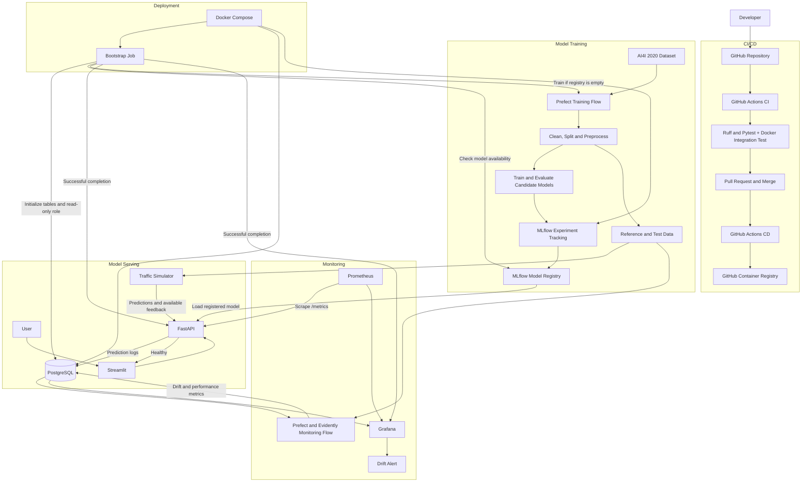

# AI4I Predictive Maintenance — End-to-End MLOps

INSY 684 | McGill University

An end-to-end machine learning system for predicting industrial machine failures using the AI4I 2020 Predictive Maintenance dataset. The project integrates reproducible training, model registration, online inference, prediction logging, data drift detection, monitoring, containerized deployment, and automated CI/CD.

## 1. Business Problem

Unexpected machine failures cause downtime, maintenance costs, and production disruptions. This system estimates the probability of machine failure from operating conditions and provides a binary prediction to support preventive maintenance decisions. Predictions are decision-support outputs, not guarantees of equipment safety.

## 2. System Architecture



## 3. Technology Stack

| Component | Technology |
|---|---|
| Data processing and modeling | Python, pandas, NumPy, scikit-learn, XGBoost |
| Workflow orchestration | Prefect |
| Experiment tracking and registry | MLflow |
| Model serving | FastAPI, Pydantic, Uvicorn |
| Frontend | Streamlit |
| Database | PostgreSQL, SQLAlchemy, psycopg |
| Drift and performance monitoring | Evidently |
| API telemetry | Prometheus |
| Dashboards and alerts | Grafana |
| Deployment | Docker, Docker Compose |
| Testing and linting | Pytest, Ruff |
| CI/CD and image registry | GitHub Actions, GHCR |

## 4. Dataset and Features

The [AI4I 2020 Predictive Maintenance Dataset](https://archive.ics.uci.edu/dataset/601/ai4i+2020+predictive+maintenance+dataset) is a synthetic industrial dataset. The binary target is `Machine failure` (0 = no failure, 1 = failure).

| Input | Meaning |
|---|---|
| Type | Machine/product quality category (L, M, H) |
| Air temperature | Kelvin |
| Process temperature | Kelvin |
| Rotational speed | RPM |
| Torque | Nm |
| Tool wear | Minutes |

Data preparation produces separate training, validation and test datasets. Preprocessing and the estimator are packaged together as a fitted scikit-learn pipeline. The held-out test data supports evaluation and simulated inference traffic. Failure-mode labels and the target are not inference inputs.

## 5. Quick Start

### Prerequisites

- Git and Docker with Docker Compose v2 (Docker Desktop is suitable).
- Available local ports: 5432, 5001, 8000, 8501, 9090 and 3000.
- Python 3.13 is recommended for running scripts or tests directly on the host; it is not required for the containerized services.

### Configuration and startup

```bash
git clone https://github.com/yaowangcodes/AI4I_Predictive_Maintenance.git
cd AI4I_Predictive_Maintenance
cp .env.example .env
```

Edit `.env` before starting. Set unique local passwords, preserve existing credentials if reusing a database volume, and leave `MODEL_VERSION` empty for a new installation. Ensure these settings are present (example values are placeholders):

```dotenv
POSTGRES_USER=ai4i_user
POSTGRES_PASSWORD=replace_with_local_password
POSTGRES_DB=ai4i_db
POSTGRES_HOST=127.0.0.1
POSTGRES_PORT=5432
MODEL_NAME=AI4I_Predictive_Maintenance
MODEL_VERSION=
MLFLOW_TRACKING_URI=http://127.0.0.1:5001
GRAFANA_ADMIN_USER=admin
GRAFANA_ADMIN_PASSWORD=replace_with_admin_password
GRAFANA_DB_USER=ai4i_grafana
GRAFANA_DB_PASSWORD=replace_with_grafana_db_password
```

Do not commit `.env`, `.env.monitoring`, or local database credentials.

```bash
mkdir -p mlflow_storage artifacts
docker compose up -d --build
docker compose ps -a
curl -fsS http://localhost:8000/health
```

Docker Compose starts PostgreSQL and MLflow, then runs the one-time bootstrap job. Bootstrap creates the tables, applies monitoring migrations, configures Grafana's dedicated read-only database role, and checks the model registry. When no ready model exists and no version is pinned, it runs the training flow and verifies the registered model. API and Grafana depend on successful bootstrap completion; Streamlit waits for the API health check. `bootstrap` showing `Exited (0)` is expected.

A specified `MODEL_VERSION` pins the deployment to that version. An empty value selects the latest ready version. The previously validated local deployment used version 7; a new registry will have its own version numbering.

| Service | Local URL |
|---|---|
| Streamlit | http://localhost:8501 |
| FastAPI Swagger | http://localhost:8000/docs |
| API health | http://localhost:8000/health |
| MLflow | http://localhost:5001 |
| Prometheus | http://localhost:9090 |
| Grafana | http://localhost:3000 |
| PostgreSQL | localhost:5432 |

Stop the stack with `docker compose down`. Do not add `-v` unless intentionally deleting stored database and monitoring volumes.

## 6. Model Training and Registry

The Prefect training flow orchestrates data loading, cleaning, splitting, preprocessing, candidate training, validation, final evaluation, model registration and reload verification. Candidate models include a dummy baseline, balanced logistic regression, random forests and XGBoost with several positive-class weights. Candidate ranking uses validation average precision, which is useful for imbalanced binary classification.

Run training explicitly when needed:

```bash
docker compose run --rm training
```

This can register a new model version and update generated artifacts. A running API does not automatically switch to a newly registered version; review the model and restart/recreate the API with the intended configuration when deploying a new version.

MLflow records parameters, validation and test metrics, fitted pipelines, model signatures and supporting artifacts. The registered model name is `AI4I_Predictive_Maintenance`. The previously selected local model was `xgboost_weight_3` (version 7). The local final pipeline is also saved as `artifacts/final_pipeline.joblib`.

Evaluation results are available in `artifacts/validation_metrics.csv`, `artifacts/test_metrics.json`, `artifacts/model_comparison.png` and `artifacts/confusion_matrix.png`. Refer to these files and the corresponding MLflow run for actual numerical scores; no unverified scores are reported here.

## 7. API and Frontend

Streamlit provides an interactive interface for entering operating conditions and viewing predictions. FastAPI loads the registered MLflow pipeline, validates requests, returns predictions and probabilities, and records inference information in PostgreSQL.

| Endpoint | Purpose |
|---|---|
| `GET /health` | Model and database readiness |
| `POST /predict` | Machine failure inference |
| `POST /feedback` | Submit an available ground-truth label |
| `GET /metrics` | Prometheus telemetry |
| `GET /docs` | Interactive OpenAPI documentation |

Example prediction:

```bash
curl -fsS -X POST http://localhost:8000/predict \
  -H 'Content-Type: application/json' \
  -d '{"Type":"M","air_temperature":298.1,"process_temperature":308.6,"rotational_speed":1551,"torque":42.8,"tool_wear":120}'
```

The response includes a prediction ID, binary prediction, failure probability, model name and model version. Feedback can associate a known outcome with a previously logged prediction; see Swagger for the exact request schema.

## 8. Monitoring and Drift Demonstration

Prometheus scrapes the API's `/metrics` endpoint to track request volume, latency and errors. PostgreSQL stores prediction logs and monitoring metrics. The Evidently monitoring flow compares a traffic batch against reference data and calculates model performance when sufficient valid ground-truth labels exist. Grafana combines operational metrics from Prometheus with stored drift and performance metrics from PostgreSQL. Dashboard and provisioning configuration are maintained under `monitoring/grafana/`.

### Normal traffic

```bash
docker compose run --rm simulator --mode normal --n 200 --delay 0.05
```

Normal traffic samples held-out test observations and submits available labels through the feedback endpoint. Record the batch ID from the simulator output.

```bash
docker compose run --rm monitoring \
  --batch-id <NORMAL_BATCH_ID> \
  --reference-model-name AI4I_Predictive_Maintenance \
  --reference-model-version <ACTIVE_MODEL_VERSION>
```

Replace the placeholders with actual values before running. Obtain the active model version from `/health`.

### Drifted traffic

```bash
docker compose run --rm simulator --mode drift --n 5000 --delay 0
```

The drift simulation shifts numerical features such as air temperature, process temperature, torque and tool wear. Labels are deliberately not reused for altered synthetic observations because the original outcome may no longer be valid.

```bash
docker compose run --rm monitoring \
  --batch-id <DRIFT_BATCH_ID> \
  --reference-model-name AI4I_Predictive_Maintenance \
  --reference-model-version <ACTIVE_MODEL_VERSION>
```

Inspect Grafana at http://localhost:3000 for operational metrics, drift share and the drift alert. The monitoring flow uses a default dataset drift-share threshold of 0.5, with a minimum batch size of 100 and a minimum labeled sample count of 30 for performance evaluation. In a previously observed local drift demonstration, 4 of 6 features drifted (66.7%), and the monitoring flow reported a drift alert. This is an observed demonstration result, not a guarantee for every simulated batch.

The monitoring flow is invoked explicitly for each batch. Data drift is distinct from demonstrated performance degradation; drifted traffic without verified labels cannot establish accuracy or recall. Drift alerts support investigation and potential retraining; automatic retraining is not claimed.

## 9. Testing

Install host dependencies and configure the local environment before running tests that require running services.

```bash
python -m pip install -r requirements.txt
python -m pip install ruff
ruff check . --select E9,F63,F7,F82
python -m pytest -q --tb=short
```

The full local suite recorded **114 passed, 17 warnings, in 6.80 seconds**. Warnings included third-party deprecations and undefined classification metrics in edge-case tests.

Test coverage includes input validation, API predictions and feedback, database operations, Prometheus instrumentation, drift and performance calculations, monitoring configuration, and traffic simulation. GitHub CI starts the required Docker services before API tests and sends a prediction request to the running API container as an integration check.

## 10. CI/CD

Workflows are defined under `.github/workflows/`.

- **CI (`ci.yml`):** runs on feature-branch pushes and pull requests targeting `main`; installs dependencies, lints code, runs tests, initializes required Docker services, and performs an HTTP prediction integration test.
- **CD (`cd.yml`):** runs on pushes to `main`; builds and publishes four custom Docker images to GitHub Container Registry (GHCR) using the GitHub Actions token. Images are tagged with `latest` and the commit SHA.

The corrected CI workflow successfully completed. The CD run triggered by the merge of PR #2 completed all four build-and-publish jobs in 2 minutes 52 seconds (merge commit `22e1726`).

| Image | Registry location |
|---|---|
| API | `ghcr.io/yaowangcodes/ai4i-api:latest` |
| Frontend | `ghcr.io/yaowangcodes/ai4i-frontend:latest` |
| Pipeline | `ghcr.io/yaowangcodes/ai4i-pipeline:latest` |
| MLflow | `ghcr.io/yaowangcodes/ai4i-mlflow:latest` |

CD publishes images rather than automatically replacing running local containers. Package visibility and external pull access must be checked separately. The Quick Start uses the repository's Compose build configuration.

Development uses feature branches and pull requests. Required CI checks and branch protection should be enforced on `main`; the actual repository settings must be verified before final submission. Preserve merge commits for an auditable contribution history.

## 11. Repository Structure

```text
.
├── .github/workflows/       # CI and CD workflows
├── api/                     # FastAPI, schemas, model loading, instrumentation
├── artifacts/               # Data splits, reference data and model outputs
├── database/                # ORM models, connections, initialization, migration
├── frontend/                # Streamlit application
├── monitoring/              # Prometheus and Grafana configuration
├── scripts/                 # Bootstrap, simulator and monitoring utilities
├── tasks/                   # Prefect training tasks
├── tests/                   # Automated tests
├── ai4i2020.csv             # Source dataset
├── config.py                # Shared configuration
├── training_flow.py         # Training orchestration
├── monitoring_flow.py       # Monitoring orchestration
├── Dockerfile.api
├── Dockerfile.frontend
├── Dockerfile.pipeline
├── Dockerfile.mlflow
├── docker-compose.yml
├── requirements.txt
├── .env.example
└── README.md
```

## 12. Demonstration Screenshots

<!-- Screenshot slots intentionally left empty. Add the actual images before final submission. -->

### MLflow Experiments and Model Registry

<!-- Insert experiment and registry screenshots here. -->

### Streamlit Prediction and FastAPI

<!-- Insert prediction UI and API screenshots here. -->

### Grafana — Normal Traffic

<!-- Insert normal dashboard screenshot here. -->

### Grafana — Drifted Traffic and Alert

<!-- Insert drift dashboard and actual alert-state screenshots here. -->

### Docker Compose and Tests

<!-- Insert container status and pytest screenshots here. -->

### GitHub Actions CI and CD

<!-- Insert successful CI and CD screenshots here. -->

### Branch Protection

<!-- Insert branch protection settings screenshot here. -->

## 13. Validation Status and Limitations

- Existing-environment Docker Compose startup was validated: six long-running services started and bootstrap exited successfully.
- Local tests and the corrected CI workflow passed; the CD image publishing workflow completed successfully.
- A separate clean-installation test on an independent local environment was not performed. Fresh-registry initialization is exercised by the configured CI workflow, but independent full-stack installation remains to be verified.
- The dataset is synthetic; performance on real industrial equipment is not established.
- Monitoring depends on valid reference data, sufficient traffic and available feedback. Alerts require human review.
- The stack is intended for local educational demonstration, not a hardened production deployment.

## 14. Contributors

<!-- Add team member names, individual responsibilities and relevant feature branches before submission. -->

## 15. References

- [UCI Machine Learning Repository — AI4I 2020 Predictive Maintenance Dataset](https://archive.ics.uci.edu/dataset/601/ai4i+2020+predictive+maintenance+dataset)
- [MLflow](https://mlflow.org/)
- [Prefect](https://www.prefect.io/)
- [Evidently](https://www.evidentlyai.com/)
- [FastAPI](https://fastapi.tiangolo.com/)
- [Prometheus](https://prometheus.io/)
- [Grafana](https://grafana.com/)
- [Docker Compose](https://docs.docker.com/compose/)
- [GitHub Actions](https://docs.github.com/en/actions)
