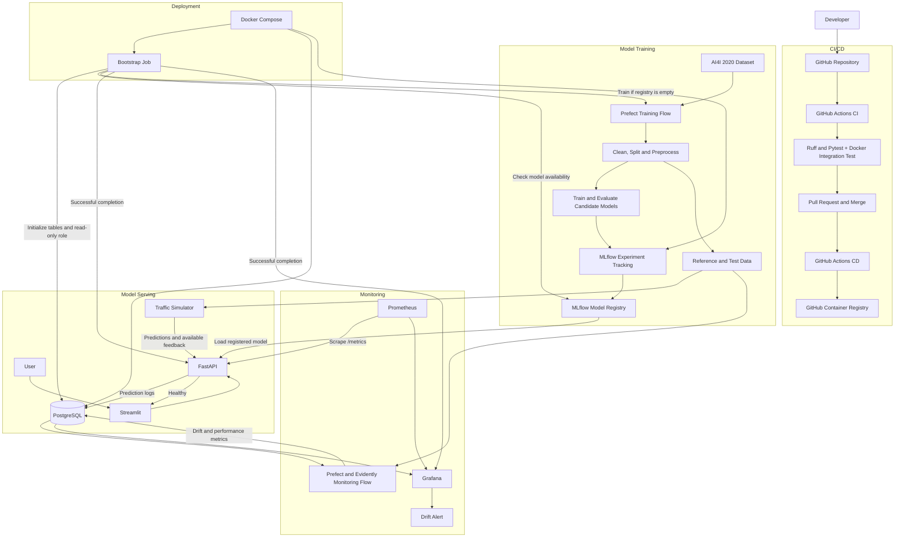
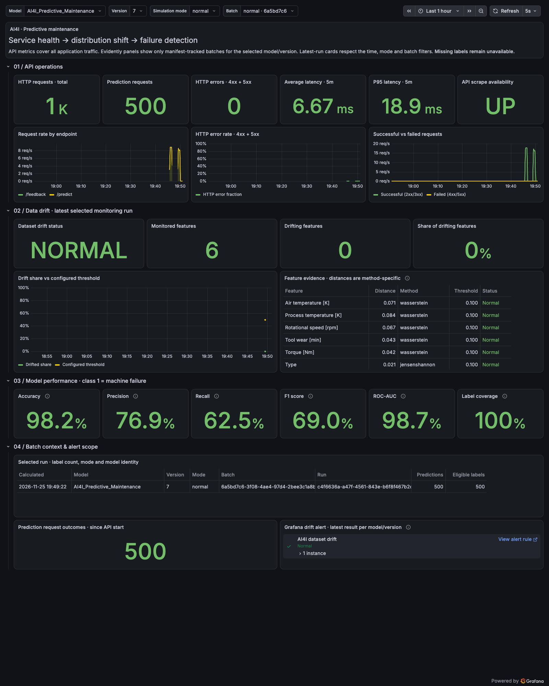

<<<<<<< Updated upstream
# AI4I Predictive Maintenance — MLOps Pipeline

INSY 684 | McGill University
=======
# AI4I Predictive Maintenance — End-to-End MLOps
Winston(Yao) Wang
>>>>>>> Stashed changes

## Overview

<<<<<<< Updated upstream
This project builds an end-to-end MLOps system for machine failure prediction using the AI4I 2020 Predictive Maintenance dataset. The system is designed to support reproducible model training, experiment tracking, model registration, prediction serving, and production monitoring.
=======
## 1. Quick Start — One-command GHCR Deployment (Recommended)

The four custom images are published to GitHub Container Registry (GHCR) by GitHub Actions. Users can download the prebuilt images instead of rebuilding the Python environments locally. PostgreSQL, Prometheus and Grafana use their upstream images.

### Prerequisites

- Git, a current Docker Compose v2 installation (Docker Desktop is suitable), Bash and OpenSSL for the deployment script. On Windows, use Git Bash with Docker Desktop running in Linux-container mode.
- Available ports: 5432, 5001, 8000, 8501, 9090 and 3000.
- All four GHCR packages must be publicly accessible for anonymous pulls. Verify the image platform matches your machine (`linux/amd64` or `linux/arm64`); a compatible emulation setup may be needed on Apple Silicon if only AMD64 images are published.
- No host Python, MLflow or PostgreSQL installation is required.

### Deploy from published images

```bash
git clone https://github.com/yaowangcodes/AI4I_Predictive_Maintenance.git
cd AI4I_Predictive_Maintenance
bash deploy.sh
```

This deployment path requires `deploy.sh` and `docker-compose.prod.yml` to be added to the repository. If they are not yet present, use the source-build alternative below. The proposed script generates local credentials on first use, preserves an existing `.env`, creates persistent directories and starts the full stack with the production override. The override removes local build definitions and maps the custom services to the published images.

| Service(s) | Published image |
|---|---|
| API | `ghcr.io/yaowangcodes/ai4i-api:latest` |
| Frontend | `ghcr.io/yaowangcodes/ai4i-frontend:latest` |
| Bootstrap, training, simulator, monitoring | `ghcr.io/yaowangcodes/ai4i-pipeline:latest` |
| MLflow | `ghcr.io/yaowangcodes/ai4i-mlflow:latest` |

After the deployment script has created `.env`, equivalent manual lifecycle commands are:

```bash
docker compose -f docker-compose.yml -f docker-compose.prod.yml --profile jobs pull
docker compose -f docker-compose.yml -f docker-compose.prod.yml up -d --no-build
docker compose -f docker-compose.yml -f docker-compose.prod.yml ps -a
curl -fsS http://localhost:8000/health
```

For a reproducible release, pin all four images to the same published commit SHA rather than the moving `latest` tag. The images do not include historical database records or the original local MLflow registry; bootstrap initializes those services on the target machine.

### Alternative: build locally from source

#### Configuration and startup

```bash
git clone https://github.com/yaowangcodes/AI4I_Predictive_Maintenance.git
cd AI4I_Predictive_Maintenance
cp .env.example .env
```

Edit `.env` before starting. Set unique local passwords, preserve existing credentials if reusing a database volume, and leave `MODEL_VERSION` empty for a new installation. Ensure these settings are present (example values are placeholders):

```dotenv
POSTGRES_USER=ai4i_user
POSTGRES_PASSWORD=replace_with_local_password
POSTGRES_DB=ai4i_db
POSTGRES_HOST=127.0.0.1
POSTGRES_PORT=5432
MODEL_NAME=AI4I_Predictive_Maintenance
MODEL_VERSION=
MLFLOW_TRACKING_URI=http://127.0.0.1:5001
GRAFANA_ADMIN_USER=admin
GRAFANA_ADMIN_PASSWORD=replace_with_admin_password
GRAFANA_DB_USER=ai4i_grafana
GRAFANA_DB_PASSWORD=replace_with_grafana_db_password
```

Do not commit `.env`, `.env.monitoring`, or local database credentials.

```bash
mkdir -p mlflow_storage artifacts
docker compose up -d --build
docker compose ps -a
curl -fsS http://localhost:8000/health
```

Docker Compose starts PostgreSQL and MLflow, then runs the one-time bootstrap job. Bootstrap creates the tables, applies monitoring migrations, configures Grafana's dedicated read-only database role, and checks the model registry. When no ready model exists and no version is pinned, it runs the training flow and verifies the registered model. API and Grafana depend on successful bootstrap completion; Streamlit waits for the API health check. `bootstrap` showing `Exited (0)` is expected.

A specified `MODEL_VERSION` pins the deployment to that version. An empty value selects the latest ready version. The previously validated local deployment used version 7; a new registry will have its own version numbering.

| Service | Local URL |
|---|---|
| Streamlit | http://localhost:8501 |
| FastAPI Swagger | http://localhost:8000/docs |
| API health | http://localhost:8000/health |
| MLflow | http://localhost:5001 |
| Prometheus | http://localhost:9090 |
| Grafana | http://localhost:3000 |
| PostgreSQL | localhost:5432 |

### Stop and restart

For GHCR deployments, use the same Compose files for all lifecycle commands:

```bash
docker compose -f docker-compose.yml -f docker-compose.prod.yml down
docker compose -f docker-compose.yml -f docker-compose.prod.yml up -d --no-build
```

For source-build deployments, use `docker compose down` and `docker compose up -d`. Do not add `-v` unless intentionally deleting stored database and monitoring volumes.

### Running training and traffic jobs after GHCR deployment

Use both Compose files for one-off jobs too, so they use the published pipeline image:

```bash
docker compose -f docker-compose.yml -f docker-compose.prod.yml run --rm --no-deps simulator --mode normal --n 200 --delay 0.05
```

Run jobs only after the stack is healthy. For subsequent training and monitoring commands in this README, replace `docker compose` with `docker compose -f docker-compose.yml -f docker-compose.prod.yml` when using GHCR. See Section 8 for the normal and drift demonstration.

**Deployment validation:** image publication and source-based CI integration have passed. The GHCR override and one-command script have been proposed but their presence in the repository, anonymous access to all four packages, and end-to-end execution on a new machine have not yet been verified.


## 2. Business Problem
>>>>>>> Stashed changes

The current implementation includes data preparation, model training and MLflow registration, FastAPI serving, traffic simulation, Evidently monitoring, PostgreSQL metrics storage, and a provisioned Prometheus/Grafana dashboard with drift alerts.

<<<<<<< Updated upstream
## Business Problem

Unexpected machine failures cause downtime, maintenance costs, and production disruptions. This system estimates the probability of machine failure from operating conditions and provides a binary prediction to support preventive maintenance decisions. Predictions are decision-support outputs, not guarantees of equipment safety.

## System Architecture

The following diagram represents the intended end-to-end architecture. Dashed connections indicate planned or in-progress integrations.
=======
## 3. System Architecture
>>>>>>> Stashed changes



<<<<<<< Updated upstream
## Implementation Status
=======
## 4. Technology Stack
>>>>>>> Stashed changes

| Component | Technology |
|---|---|
| Data processing and modeling | Python, pandas, NumPy, scikit-learn, XGBoost |
| Workflow orchestration | Prefect |
| Experiment tracking and registry | MLflow |
| Model serving | FastAPI, Pydantic, Uvicorn |
| Frontend | Streamlit |
| Database | PostgreSQL, SQLAlchemy, psycopg |
| Drift and performance monitoring | Evidently |
| API telemetry | Prometheus |
| Dashboards and alerts | Grafana |
| Deployment | Docker, Docker Compose |
| Testing and linting | Pytest, Ruff |
| CI/CD and image registry | GitHub Actions, GHCR |

<<<<<<< Updated upstream
## Project Structure
=======
## 5. Dataset and Features
>>>>>>> Stashed changes

```text
684project/
├── tasks/
│   ├── data_preparation.py
│   └── model_training.py
├── database/
│   ├── __init__.py
│   ├── connection.py
│   ├── models.py
│   ├── init_db.py
│   ├── test_connection.py
│   └── test_database.py
├── api/                       # Model serving and Prometheus instrumentation
│   ├── __init__.py
│   ├── main.py
│   ├── schemas.py
│   ├── model_loader.py
│   ├── prediction_service.py
│   └── test_api.py
├── artifacts/                 # Generated datasets and artifacts
├── ai4i2020.csv
├── config.py
├── training_flow.py
├── docker-compose.yml
├── requirements.txt
├── .env.example
├── .gitignore
└── README.md
```

The tree reflects the current development plan; API files and other unconfirmed files may not yet exist. Local runtime files such as `.env` and `mlflow.db` are not shown.

## Getting Started

<<<<<<< Updated upstream
### 1. Install dependencies

Requirements: Python, pip, Docker Desktop with Docker Compose, and Git. Use a dedicated virtual environment for reproducibility. Use the Python version validated by the project; the current local development environment uses Python 3.13.

```bash
git clone https://github.com/yaowangcodes/AI4I_Predictive_Maintenance.git
cd AI4I_Predictive_Maintenance
cp .env.example .env
```

Edit `.env` before starting. Set unique local passwords, preserve existing credentials if reusing a database volume, and leave `MODEL_VERSION` empty for a new installation. Ensure these settings are present (example values are placeholders):

```dotenv
POSTGRES_USER=ai4i_user
POSTGRES_PASSWORD=replace_with_local_password
POSTGRES_DB=ai4i_db
POSTGRES_HOST=127.0.0.1
POSTGRES_PORT=5432
MODEL_NAME=AI4I_Predictive_Maintenance
MODEL_VERSION=
MLFLOW_TRACKING_URI=http://127.0.0.1:5001
GRAFANA_ADMIN_USER=admin
GRAFANA_ADMIN_PASSWORD=replace_with_admin_password
GRAFANA_DB_USER=ai4i_grafana
GRAFANA_DB_PASSWORD=replace_with_grafana_db_password
```

Do not commit `.env`, `.env.monitoring`, or local database credentials.

```bash
docker compose up -d postgres
docker compose ps
docker exec ai4i_postgres pg_isready -U ai4i_user -d ai4i_db
python -m database.init_db
```

If pgAdmin is configured in Docker Compose, start it with `docker compose up -d pgadmin` and open http://127.0.0.1:5050. Register PostgreSQL using host `postgres`, port `5432`, and the credentials defined in `.env`.

### 4. Start MLflow

In a separate terminal, from the project root:
=======
## 6. Model Training and Registry

The Prefect training flow orchestrates data loading, cleaning, splitting, preprocessing, candidate training, validation, final evaluation, model registration and reload verification. Candidate models include a dummy baseline, balanced logistic regression, random forests and XGBoost with several positive-class weights. Candidate ranking uses validation average precision, which is useful for imbalanced binary classification.

Run training explicitly when needed:
>>>>>>> Stashed changes

```bash
mlflow server --backend-store-uri sqlite:///mlflow.db --host 127.0.0.1 --port 5001
```

Keep the server running and open http://127.0.0.1:5001.

Ensure `config.py` and the training tasks use the same tracking URI:

```python
MLFLOW_TRACKING_URI = "http://127.0.0.1:5001"
EXPERIMENT_NAME = "AI4I_predictive_maintenance"
```

Port 5001 avoids the macOS AirPlay Receiver conflict commonly encountered on port 5000. If the named experiment was previously soft-deleted, restore it in MLflow before training or deliberately choose a new experiment name.

### 5. Run the training pipeline

In another terminal:

```bash
docker compose run --rm training
```

This can register a new model version and update generated artifacts. A running API does not automatically switch to a newly registered version; review the model and restart/recreate the API with the intended configuration when deploying a new version.

MLflow records parameters, validation and test metrics, fitted pipelines, model signatures and supporting artifacts. The registered model name is `AI4I_Predictive_Maintenance`. The previously selected local model was `xgboost_weight_3` (version 7). The local final pipeline is also saved as `artifacts/final_pipeline.joblib`.

Evaluation results are available in `artifacts/validation_metrics.csv`, `artifacts/test_metrics.json`, `artifacts/model_comparison.png` and `artifacts/confusion_matrix.png`. Refer to these files and the corresponding MLflow run for actual numerical scores; no unverified scores are reported here.

## 7. API and Frontend

Streamlit provides an interactive interface for entering operating conditions and viewing predictions. FastAPI loads the registered MLflow pipeline, validates requests, returns predictions and probabilities, and records inference information in PostgreSQL.

| Endpoint | Purpose |
|---|---|
| `GET /health` | Model and database readiness |
| `POST /predict` | Machine failure inference |
| `POST /feedback` | Submit an available ground-truth label |
| `GET /metrics` | Prometheus telemetry |
| `GET /docs` | Interactive OpenAPI documentation |

Example prediction:

```bash
curl -fsS -X POST http://localhost:8000/predict \
  -H 'Content-Type: application/json' \
  -d '{"Type":"M","air_temperature":298.1,"process_temperature":308.6,"rotational_speed":1551,"torque":42.8,"tool_wear":120}'
```

The response includes a prediction ID, binary prediction, failure probability, model name and model version. Feedback can associate a known outcome with a previously logged prediction; see Swagger for the exact request schema.

## 8. Monitoring and Drift Demonstration

Prometheus scrapes the API's `/metrics` endpoint to track request volume, latency and errors. PostgreSQL stores prediction logs and monitoring metrics. The Evidently monitoring flow compares a traffic batch against reference data and calculates model performance when sufficient valid ground-truth labels exist. Grafana combines operational metrics from Prometheus with stored drift and performance metrics from PostgreSQL. Dashboard and provisioning configuration are maintained under `monitoring/grafana/`.

### Normal traffic

```bash
docker compose run --rm simulator --mode normal --n 200 --delay 0.05
```

Normal traffic samples held-out test observations and submits available labels through the feedback endpoint. Record the batch ID from the simulator output.

```bash
docker compose run --rm monitoring \
  --batch-id <NORMAL_BATCH_ID> \
  --reference-model-name AI4I_Predictive_Maintenance \
  --reference-model-version <ACTIVE_MODEL_VERSION>
```

Replace the placeholders with actual values before running. Obtain the active model version from `/health`.

### Drifted traffic

```bash
docker compose run --rm simulator --mode drift --n 5000 --delay 0
```

The drift simulation shifts numerical features such as air temperature, process temperature, torque and tool wear. Labels are deliberately not reused for altered synthetic observations because the original outcome may no longer be valid.

```bash
docker compose run --rm monitoring \
  --batch-id <DRIFT_BATCH_ID> \
  --reference-model-name AI4I_Predictive_Maintenance \
  --reference-model-version <ACTIVE_MODEL_VERSION>
```

Inspect Grafana at http://localhost:3000 for operational metrics, drift share and the drift alert. The monitoring flow uses a default dataset drift-share threshold of 0.5, with a minimum batch size of 100 and a minimum labeled sample count of 30 for performance evaluation. In a previously observed local drift demonstration, 4 of 6 features drifted (66.7%), and the monitoring flow reported a drift alert. This is an observed demonstration result, not a guarantee for every simulated batch.

The monitoring flow is invoked explicitly for each batch. Data drift is distinct from demonstrated performance degradation; drifted traffic without verified labels cannot establish accuracy or recall. Drift alerts support investigation and potential retraining; automatic retraining is not claimed.

## 9. Testing

Install host dependencies and configure the local environment before running tests that require running services.

```bash
python -m pip install -r requirements.txt
python -m pip install ruff
ruff check . --select E9,F63,F7,F82
python -m pytest -q --tb=short
```

The full local suite recorded **114 passed, 17 warnings, in 6.80 seconds**. Warnings included third-party deprecations and undefined classification metrics in edge-case tests.

Test coverage includes input validation, API predictions and feedback, database operations, Prometheus instrumentation, drift and performance calculations, monitoring configuration, and traffic simulation. GitHub CI starts the required Docker services before API tests and sends a prediction request to the running API container as an integration check.

## 10. CI/CD

Workflows are defined under `.github/workflows/`.

- **CI (`ci.yml`):** runs on feature-branch pushes and pull requests targeting `main`; installs dependencies, lints code, runs tests, initializes required Docker services, and performs an HTTP prediction integration test.
- **CD (`cd.yml`):** runs on pushes to `main`; builds and publishes four custom Docker images to GitHub Container Registry (GHCR) using the GitHub Actions token. Images are tagged with `latest` and the commit SHA.

The corrected CI workflow successfully completed. The CD run triggered by the merge of PR #2 completed all four build-and-publish jobs in 2 minutes 52 seconds (merge commit `22e1726`).

| Image | Registry location |
|---|---|
| `ai4i_http_requests_total` | HTTP responses by method, normalized route, status |
| `ai4i_http_errors_total` | Responses with status 400 or higher, same labels |
| `ai4i_http_request_duration_seconds` | Histogram of full-response duration, including failures |
| `ai4i_prediction_requests_total` | POST `/predict` responses by status, including validation failures |

<<<<<<< Updated upstream
Unknown URLs share `endpoint="unmatched"`; path parameters remain route templates.
There are no batch IDs, prediction IDs, features, or user identifiers in Prometheus
labels. Scrapes are excluded from application counters and latency. Each app has
an isolated registry, and repeated instrumentation does not register duplicate
collectors. Counters reset on API restart, including development auto-reloads;
Prometheus `rate()` handles resets. Totals describe the current process lifetime,
not all PostgreSQL history. API availability means successful scraping, not a
separate database/model readiness probe; `/health` remains available for readiness.
=======
CD publishes images rather than automatically replacing running local containers. Package visibility and external pull access must be checked separately. The Quick Start documents the proposed GHCR deployment override and retains the verified source-build alternative.
>>>>>>> Stashed changes

Example queries (the dashboard includes equivalent queries):

```promql
sum(rate(ai4i_http_requests_total{job="ai4i-api"}[1m]))

<<<<<<< Updated upstream
sum(rate(ai4i_http_request_duration_seconds_sum{job="ai4i-api"}[5m]))
/ sum(rate(ai4i_http_request_duration_seconds_count{job="ai4i-api"}[5m]))

histogram_quantile(0.95,
  sum by (le) (rate(ai4i_http_request_duration_seconds_bucket{job="ai4i-api"}[5m])))

(sum(rate(ai4i_http_errors_total{job="ai4i-api"}[1m])) or vector(0))
/ clamp_min(sum(rate(ai4i_http_requests_total{job="ai4i-api"}[1m])), 0.000001)

sum by (status) (ai4i_prediction_requests_total{job="ai4i-api"})
=======
```text
.
├── .github/workflows/       # CI and CD workflows
├── api/                     # FastAPI, schemas, model loading, instrumentation
├── artifacts/               # Data splits, reference data and model outputs
├── database/                # ORM models, connections, initialization, migration
├── frontend/                # Streamlit application
├── monitoring/              # Prometheus and Grafana configuration
├── scripts/                 # Bootstrap, simulator and monitoring utilities
├── tasks/                   # Prefect training tasks
├── tests/                   # Automated tests
├── ai4i2020.csv             # Source dataset
├── config.py                # Shared configuration
├── training_flow.py         # Training orchestration
├── monitoring_flow.py       # Monitoring orchestration
├── Dockerfile.api
├── Dockerfile.frontend
├── Dockerfile.pipeline
├── Dockerfile.mlflow
├── docker-compose.yml
├── docker-compose.prod.yml  # GHCR override (proposed addition)
├── deploy.sh                # One-command deployment (proposed addition)
├── requirements.txt
├── .env.example
└── README.md
>>>>>>> Stashed changes
```

### Dashboard and alert behavior

The version-controlled dashboard is
`monitoring/grafana/dashboards/ai4i-monitoring.json`. Provisioning automatically
loads it, both data sources, and the drift rule. `monitoring/build_dashboard.py`
regenerates the JSON after intentional source changes. SQL dashboard filters
select one model/version, optionally one simulation mode/batch, and a time range.
Latest-run cards all select the **same run**, so an unlabeled drift run never
borrows performance metrics from an older labeled normal run. Feature scores
appear in a table with their methods and thresholds; incompatible distances are
not pooled into a single score. The trend shows drift share and its stored
configured threshold. Label coverage and eligible label counts remain explicit.

Grafana evaluates `AI4I dataset drift` every **10 seconds**, without a pending delay.
It selects the latest `dataset_drift` record per model name/version across tracked
simulation batches. A stored value of 1 fires; 0 recovers. This uses Evidently's
actual decision, so it stays consistent if `--drift-share` changes. Model/version
are stable alert labels; batch IDs are not, allowing a new normal batch to recover
the existing alert instance. Dashboard mode/batch filters do **not** alter alert
scope. Alert annotations identify the affected model and link to the dashboard.

An empty, insufficient, null, or older-than-24-hours latest result is **No Data**,
not confirmed normal. Query failures are **Error**. The freshness window is a
local demonstration setting in `provisioning/alerting/drift.yml`; tune it for
actual monitoring cadence. An older valid result is not used to hide a newer
insufficient result. No external contact point is needed to observe the state in
Grafana Alerting. External notifications and automatic retraining are not configured.
Grafana reads stored Evidently results; it does not calculate Evidently statistics.

### Repeatable normal → drift → recovery demonstration

Run each step separately and inspect the dashboard link printed by the command.
Each command generates a new batch and then invokes the Prefect monitoring flow:

```bash
mkdir -p artifacts/monitoring/prefect
export PREFECT_HOME="$PWD/artifacts/monitoring/prefect"
export PREFECT_SERVER_ANALYTICS_ENABLED=false
export DO_NOT_TRACK=1

python scripts/demo_monitoring.py --mode normal \
  --reference-model-name AI4I_Predictive_Maintenance --reference-model-version 7
python scripts/verify_monitoring_stack.py --expect normal

python scripts/demo_monitoring.py --mode drift \
  --reference-model-name AI4I_Predictive_Maintenance --reference-model-version 7
python scripts/verify_monitoring_stack.py --expect drift

python scripts/demo_monitoring.py --mode normal \
  --reference-model-name AI4I_Predictive_Maintenance --reference-model-version 7
python scripts/verify_monitoring_stack.py --expect normal
```

Version 7 is the existing deployment used for this demonstration, not a code
default. Confirm reference provenance as described in Step 7.4. The demo defaults
to 500 requests, seed 42, and a 0.02-second delay, with optional `--n`, `--seed`,
`--delay`, `--drift-strength`, and `--api-url`. Allow at least one scrape and alert
evaluation interval after each run; the verification script polls for up to one
minute. `demo-latest-normal.json` / `demo-latest-drift.json` under
`artifacts/monitoring/` record the actual batch, run, and dashboard link.

### Screenshots from the local demonstration

These are captures of the live, provisioned Grafana dashboard, not mockups.

Normal traffic: labeled performance, no detected feature drift, normal alert.



Injected drift: shifted feature evidence, dataset drift alert, and unavailable
performance because the modified observations have no valid ground truth.


<<<<<<< Updated upstream
To recapture after the corresponding demo step, optionally install the screenshot
helper's development dependency. It uses an installed Chrome browser; it is not
needed by the API, monitoring flow, or Docker services:
=======
- Existing-environment Docker Compose startup was validated: six long-running services started and bootstrap exited successfully.
- Local tests and the corrected CI workflow passed; the CD image publishing workflow completed successfully.
- GHCR publication is confirmed; the proposed deployment script and override have not been independently tested.
- A separate clean-installation test on an independent local environment was not performed. Fresh-registry initialization is exercised by the configured CI workflow, but independent full-stack installation remains to be verified.
- The dataset is synthetic; performance on real industrial equipment is not established.
- Monitoring depends on valid reference data, sufficient traffic and available feedback. Alerts require human review.
- The stack is intended for local educational demonstration, not a hardened production deployment.
>>>>>>> Stashed changes

```bash
python -m pip install playwright==1.56.0
python scripts/capture_monitoring.py --mode normal
python scripts/capture_monitoring.py --mode drift
```

Use `--chrome-path` on systems where Chrome has a different executable path.
Capture the normal screenshot before generating drift so the live alert panel
matches the shown phase. Stop editing Python files during capture if the API was
started with `--reload`, since edits restart the process and reset counters.

### Validation and troubleshooting

```bash
python -m pytest tests/test_prometheus.py tests/test_monitoring_config.py \
  tests/test_monitoring.py tests/test_traffic_simulator.py -q
python -m pytest tests/test_api.py database/ -q

docker compose --env-file .env --env-file .env.monitoring exec -T prometheus \
  promtool check config /etc/prometheus/prometheus.host.yml
```

If Prometheus shows DOWN, check `/metrics` returns text, the API process is running,
and the selected host/container target matches the deployment mode. If Grafana
has no database data, run the migration and `setup_grafana.py`, check data-source
health, and widen the dashboard time range. Insufficient batches produce null
statistical results by design. Provisioning changes to alerts/data sources require
restarting Grafana; dashboard JSON is refreshed from disk automatically. Historical
manual/API-test prediction rows are not pulled into Evidently dashboard results.

### Verified Step 7.5–7.8 results (2026-11-25)

- **101 offline tests passed**, including instrumentation, provisioning/query
  configuration, Evidently, and traffic-simulator tests.
- **13 existing API/database integration tests passed** with the updated endpoint
  contracts. Both Prometheus configurations passed `promtool`; both Compose modes
  passed configuration validation without exposing expanded secrets.
- Prometheus reported the API target **UP**. Grafana reported both data sources
  healthy and automatically loaded all 29 dashboard panels/section headers.
- Normal batch `6a5bd7c6-3f08-4ae4-97d4-2bee3c1a8baa` had 500 labeled predictions,
  0/6 drifting features, and a **Normal** alert. Its screenshot monitoring run was
  `c4f6636a-a47f-4561-843e-b6f8f467b2db`.
- Drift batch `82d53811-78c6-42ab-a2e5-a651482dbf88`, run
  `f4467baf-1641-42e5-b458-1d252520737b`, had 500 unlabeled predictions, 4/6 drifting
  features (66.7%), and a verified **Firing** alert. Performance stayed unavailable.
- Monitoring an existing five-row batch produced **No Data**, not normal. A fresh
  evaluation of the normal batch (run `60401ec7-4ee8-4260-9acd-9ff0b20753de`)
  subsequently restored **Normal**. API-retrieved evidence is saved beside the
  screenshots as `normal-state.json`, `drift-state.json`, `no-data-state.json`, and
  `recovery-state.json`.
- The optional API image built successfully and passed `/health`, `/metrics`, and
  `/model-metrics` checks on temporary port 18000. This test used a temporary
  MLflow listener on port 5002 against the same existing registry, with the Docker
  hostname explicitly allowed. Both temporary services were removed/stopped;
  the original host API and MLflow processes remain unchanged.
- Grafana's database role was verified to have monitoring SELECT access but no
  monitoring INSERT or prediction-table SELECT privilege.

Prometheus and Grafana are left running, with the latest alert state confirmed
Normal. Existing upstream dependency/deprecation warnings remain. No model was
retrained, no data volumes were reset, and no changes were pushed or merged.
