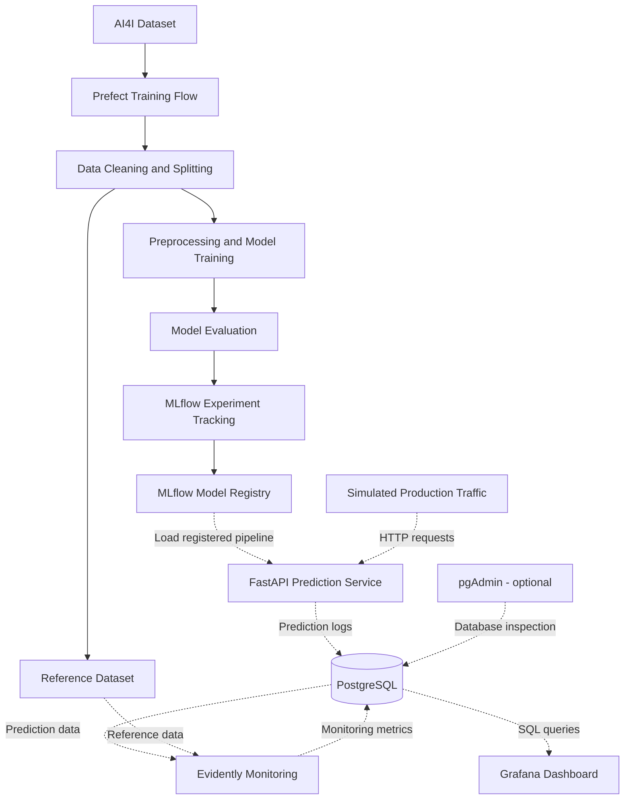
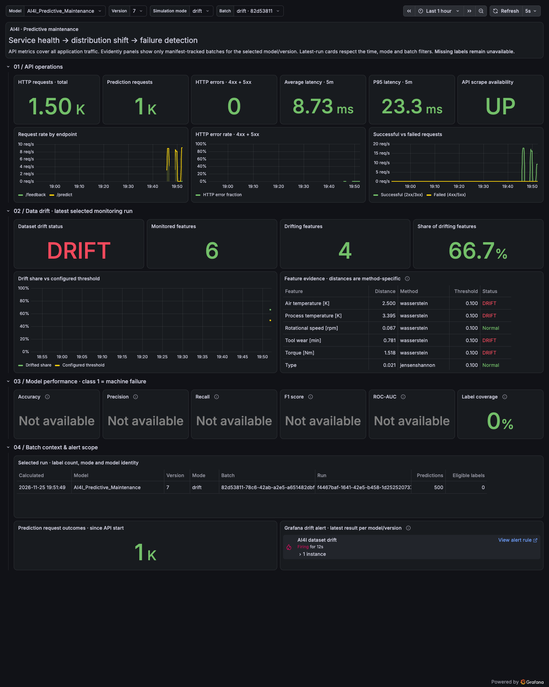

# AI4I Predictive Maintenance — MLOps Pipeline

INSY 684 | McGill University

## Overview

This project builds an end-to-end MLOps system for machine failure prediction using the AI4I 2020 Predictive Maintenance dataset. The system is designed to support reproducible model training, experiment tracking, model registration, prediction serving, and production monitoring.

The current implementation includes data preparation, model training and MLflow registration, FastAPI serving, traffic simulation, Evidently monitoring, PostgreSQL metrics storage, and a provisioned Prometheus/Grafana dashboard with drift alerts.

## Business Problem

Unexpected machine failures can cause production downtime and maintenance costs. The project aims to identify potentially failing equipment using operational measurements, supporting proactive maintenance decisions. The dataset is synthetic, so the project demonstrates technical feasibility rather than validated performance in a real industrial setting.

## Dataset

Source: [UCI AI4I 2020 Predictive Maintenance Dataset](https://archive.ics.uci.edu/dataset/601/ai4i+2020+predictive+maintenance+dataset).

| Feature | Description |
|---|---|
| Type | Product quality category (L, M, H) |
| Air temperature [K] | Ambient temperature |
| Process temperature [K] | Process temperature |
| Rotational speed [rpm] | Rotational speed |
| Torque [Nm] | Applied torque |
| Tool wear [min] | Tool usage duration |
| Machine failure | Binary target: 0 = no failure, 1 = failure |

Identifiers and failure-mode labels should not be used as prediction inputs. The training pipeline uses separate training, validation, and test datasets and preserves reference data for future drift monitoring. The intended evaluation includes precision, recall, F1, and ROC-AUC alongside accuracy because failures are relatively infrequent.

## System Architecture

The following diagram represents the intended end-to-end architecture. Dashed connections indicate planned or in-progress integrations.



## Implementation Status

| Component | Technology | Status |
|---|---|---|
| Data preparation | Pandas, NumPy, Scikit-learn | Implemented |
| Model development | Scikit-learn | Implemented |
| Experiment tracking and model registry | MLflow | Implemented |
| Training orchestration | Prefect | Implemented |
| Database setup and integration tests | PostgreSQL, SQLAlchemy | Implemented; local tests passed |
| Model serving | FastAPI, Uvicorn, Pydantic | Implemented |
| Production traffic simulation | Python | Implemented |
| Drift and performance monitoring | Evidently, Prefect, PostgreSQL | Implemented |
| Monitoring dashboard and drift alerting | Grafana, Prometheus | Implemented |
| GitHub Actions and branch protection | GitHub | Final verification pending |

## Project Structure

```text
684project/
├── tasks/
│   ├── data_preparation.py
│   └── model_training.py
├── database/
│   ├── __init__.py
│   ├── connection.py
│   ├── models.py
│   ├── init_db.py
│   ├── test_connection.py
│   └── test_database.py
├── api/                       # Model serving and Prometheus instrumentation
│   ├── __init__.py
│   ├── main.py
│   ├── schemas.py
│   ├── model_loader.py
│   ├── prediction_service.py
│   └── test_api.py
├── artifacts/                 # Generated datasets and artifacts
├── ai4i2020.csv
├── config.py
├── training_flow.py
├── docker-compose.yml
├── requirements.txt
├── .env.example
├── .gitignore
└── README.md
```

The tree reflects the current development plan; API files and other unconfirmed files may not yet exist. Local runtime files such as `.env` and `mlflow.db` are not shown.

## Getting Started

### 1. Install dependencies

Requirements: Python, pip, Docker Desktop with Docker Compose, and Git. Use a dedicated virtual environment for reproducibility. Use the Python version validated by the project; the current local development environment uses Python 3.13.

```bash
python -m pip install -r requirements.txt
```

Download the dataset from UCI and place `ai4i2020.csv` in the project root if it is not already available.

### 2. Configure environment variables

Create `.env` using `.env.example` if available, or use the following local development template. Replace the placeholder password before starting PostgreSQL.

```dotenv
POSTGRES_USER=ai4i_user
POSTGRES_PASSWORD=replace_with_local_password
POSTGRES_DB=ai4i_db
POSTGRES_HOST=127.0.0.1
POSTGRES_PORT=5432
```

If the optional pgAdmin service is configured, also define `PGADMIN_DEFAULT_EMAIL` and `PGADMIN_DEFAULT_PASSWORD`.

Never commit `.env`, credentials, or local database files to the public repository.

### 3. Start PostgreSQL

From the project root, with Docker Desktop running:

```bash
docker compose up -d postgres
docker compose ps
docker exec ai4i_postgres pg_isready -U ai4i_user -d ai4i_db
python -m database.init_db
```

If pgAdmin is configured in Docker Compose, start it with `docker compose up -d pgadmin` and open http://127.0.0.1:5050. Register PostgreSQL using host `postgres`, port `5432`, and the credentials defined in `.env`.

### 4. Start MLflow

In a separate terminal, from the project root:

```bash
mlflow server --backend-store-uri sqlite:///mlflow.db --host 127.0.0.1 --port 5001
```

Keep the server running and open http://127.0.0.1:5001.

Ensure `config.py` and the training tasks use the same tracking URI:

```python
MLFLOW_TRACKING_URI = "http://127.0.0.1:5001"
EXPERIMENT_NAME = "AI4I_predictive_maintenance"
```

Port 5001 avoids the macOS AirPlay Receiver conflict commonly encountered on port 5000. If the named experiment was previously soft-deleted, restore it in MLflow before training or deliberately choose a new experiment name.

### 5. Run the training pipeline

In another terminal:

```bash
python training_flow.py
```

Prefect orchestrates data preparation, preprocessing, model training, evaluation, MLflow logging, and final model registration. Training runs as a Python flow rather than relying on Jupyter Notebook.

Review the resulting experiment runs and registered model in MLflow. Actual model names, versions, and evaluation scores should be taken from the completed runs, not assumed from this README.

## Database Design

PostgreSQL supports prediction logging and monitoring separately from the MLflow SQLite metadata database.

| Table | Main fields | Purpose |
|---|---|---|
| `prediction_logs` | `id`, `features`, `prediction`, `probability`, `actual_label`, `model_name`, `model_version`, `predicted_at`, `labeled_at` | Stores prediction requests, outputs, model identity, and delayed ground truth |
| `monitoring_metrics` | `id`, `metric_name`, `metric_value`, `feature_name`, `threshold`, `status`, `sample_size`, `model_name`, `model_version`, `window_start`, `window_end`, `calculated_at` | Stores monitoring results for future dashboard queries |

Input features are stored as PostgreSQL JSONB. Actual labels can be null until ground truth becomes available. Monitoring metrics use a long-format schema to accommodate feature-level and model-level metrics.

## Testing

With PostgreSQL running and tables initialized:

```bash
python -m database.test_connection
python -m database.test_database
python -m pytest database/ -v
```

The database tests verify connectivity, insertion and retrieval of prediction logs, ground-truth updates, and insertion and retrieval of monitoring metrics. Test transactions are rolled back to avoid contaminating production logs.

These are integration tests requiring a running PostgreSQL instance. GitHub Actions must provision a test database and initialize its schema before running them. Local test success has been reported; CI execution remains to be verified.

## Model Serving

Start the local FastAPI server with:

```bash
python -m uvicorn api.main:app --host 127.0.0.1 --port 8000 --reload
```

Interactive API documentation: http://127.0.0.1:8000/docs.

Endpoints:

| Method | Endpoint | Purpose |
|---|---|---|
| GET | `/` | Service information |
| GET | `/health` | Health check |
| POST | `/predict` | Validate inputs, run prediction, and persist prediction logs |
| POST | `/feedback` | Record delayed ground truth |
| GET | `/model-metrics` | Read Evidently results from PostgreSQL as JSON |
| GET | `/metrics` | Prometheus operational metrics |

The serving layer loads the complete registered pipeline, including preprocessing, and records the actual loaded model name/version with each prediction.

## Monitoring Roadmap

1. Simulate production requests using normal and shifted input distributions.
2. Compare current features against the saved reference dataset using Evidently.
3. Calculate model performance only for records with available ground-truth labels.
4. Persist monitoring results in PostgreSQL.
5. Visualize drift, precision, recall, F1, and other selected metrics in Grafana.
6. Define and validate alert thresholds, then integrate monitoring into an automated workflow.

## Local Services

| Service | Address | Status |
|---|---|---|
| MLflow | http://127.0.0.1:5001 | Implemented |
| PostgreSQL | 127.0.0.1:5432 | Implemented |
| pgAdmin | http://127.0.0.1:5050 | Optional |
| Prefect | Automatically assigned temporary server | Implemented |
| FastAPI | http://127.0.0.1:8000 | Implemented |
| Grafana | http://127.0.0.1:3000 | Provisioned |
| Prometheus | http://127.0.0.1:9090 | Provisioned |

## Development Workflow

Use task-specific branches such as `feature/database` or `feature/model-serving`, commit changes with descriptive messages, and open pull requests into the protected main branch. Configure GitHub Actions to run linting and appropriate automated tests. Keep credentials out of source control and document dependency versions before final submission.

## Limitations

- The source dataset is synthetic and does not establish real-world predictive maintenance effectiveness.
- Model performance and registered model metadata are not reported here because verified evaluation outputs have not been supplied.
- Full-stack containerization beyond the monitoring services and optional API remains future work.
- The setup instructions should be validated from a clean environment before final submission.

## Traffic simulator (Step 7.1)

`scripts/simulate_traffic.py` sends held-out observations to the existing FastAPI
service using Pandas and Requests. It does not train or register models. Install
`requirements.txt`, retain `artifacts/test.csv`, and start PostgreSQL, MLflow, and
FastAPI using the instructions above. The API's `.env` must specify `MODEL_NAME`
and `MODEL_VERSION` for an existing registered model. Do not rerun training just
to generate traffic when the saved dataset and registered model already exist.

From the project root:

```bash
python scripts/simulate_traffic.py --mode normal --n 5
python scripts/simulate_traffic.py --mode normal --n 500 --delay 0.1
python scripts/simulate_traffic.py --mode drift --n 500 --delay 0.1
python scripts/simulate_traffic.py --mode drift --n 500 --drift-strength 2
```

Normal mode preserves feature values and sends the same row's `Machine failure`
label to `POST /feedback` after a successful `POST /predict`. Sampling is with
replacement, so any positive request count is supported, including counts larger
than the test set. The default seed is `config.SEED` (42). Equal seeds and sample
sizes select the same source rows in both modes, provided the dataset is unchanged.
Repeated observations are expected and should not be treated as independent new
measurements when interpreting later performance results.

Drift mode adds 5 K to air temperature, 5 K to process temperature, 15 Nm to torque,
and 50 minutes to tool wear, multiplied by `--drift-strength` (default 1). Product
type and rotational speed stay unchanged. Fractional tool-wear increments round
to the nearest whole minute using Python's `round` (ties to even), as required by
the API's integer field. Strength must be finite and nonnegative. Inputs are
validated against the existing API schema before any requests are sent. The CSV
is never modified. Drift mode never submits ground truth, including at strength
zero: original labels are not valid evidence for changed operating conditions.
No performance scores or replacement labels are fabricated.

Additional options:

```bash
API_URL=http://api:8000 python scripts/simulate_traffic.py --mode drift --n 5
python scripts/simulate_traffic.py --api-url http://127.0.0.1:8000 --seed 123 --timeout 10
python scripts/simulate_traffic.py --dataset artifacts/test.csv --manifest-dir artifacts/traffic_batches
```

`--api-url` overrides the exported `API_URL` environment variable. Inside Compose,
use the API service's DNS name and mount the dataset and a persistent writable
manifest directory. The simulator does not load `.env`; it needs only the API
address, not database credentials. Delay is between prediction cycles (including
normal-mode feedback). Timeout applies to each HTTP call. No requests are retried,
since these endpoints do not provide idempotency guarantees.

### Storage and batch identification

The existing API commits each prediction into `prediction_logs` and returns its
ID, label, failure probability, model name, and model version. Feedback updates
`actual_label` and `labeled_at` on that same row. Drift rows remain unlabeled.
There are no database migrations or changes to prediction logging.

Each run creates a UUID-named JSON manifest in `artifacts/traffic_batches/` with
mode, UTC timestamps, seed, dataset SHA-256, drift offsets, returned prediction
IDs, model metadata, zero-based source row positions, per-request outcomes, and
summary counts/latencies. It is saved atomically before requests and after each
prediction and feedback attempt. Preserve these files alongside the database:
future Evidently jobs should select the exact IDs from one manifest and compare
their stored features with `artifacts/reference.csv`, which contains training
features. Only successfully labeled normal records should enter performance
monitoring.

Simulation IDs can be separated from unrelated manual and API-test records using
these manifests. Historical manual and test records have no provenance field;
their individual origins cannot be recovered reliably. Do not infer their origin
from timestamps or labels. Use exact manifest membership to exclude both from
simulation analysis. Existing API integration tests create records outside these
manifests.

A timeout or invalid response can occur after a server commit. Such attempts are
marked `failed_or_unknown` (or `pending` after interruption), and may have no
recoverable ID. They must not be silently included in a batch by a time window.
Fully eliminating this ambiguity would require a future API idempotency or
server-side batch identifier. A hard process termination can leave a manifest
with status `running`; inspect its pending attempts before using it.

The final summary reports attempted/successful/failed predictions and feedback,
elapsed time, and average prediction HTTP latency over all attempts (excluding
feedback and delay). Exit codes are 0 for success, 1 for request/data/file errors,
2 for invalid CLI arguments, and 130 for keyboard interruption. Error logs omit
response bodies, credentials, and connection exception details.

### Verification

Offline simulator tests:

```bash
python -m pytest tests/test_traffic_simulator.py -q
```

Existing API integration tests require PostgreSQL and MLflow:

```bash
python -m pytest tests/test_api.py -q
```

Copy `prediction_ids` from a specific manifest into the SQL arrays below (replace
`101, 102, 103` with the actual IDs). Run against the API's PostgreSQL database:

```sql
-- Exact batch records, including persisted inputs and served model identity.
SELECT id, features, prediction, probability, actual_label,
       model_name, model_version, predicted_at, labeled_at
FROM prediction_logs
WHERE id = ANY(ARRAY[101, 102, 103]::integer[])
ORDER BY id;

-- Check all returned IDs exist and inspect labeling per served model.
WITH batch(id) AS (SELECT unnest(ARRAY[101, 102, 103]::integer[]))
SELECT p.model_name, p.model_version,
       count(*) AS requested_ids, count(p.id) AS stored_predictions,
       count(p.actual_label) AS labeled_predictions,
       count(p.labeled_at) AS feedback_timestamps
FROM batch b LEFT JOIN prediction_logs p ON p.id = b.id
GROUP BY p.model_name, p.model_version;

-- Must return zero for a drift manifest, absent later valid external labeling.
SELECT count(*) AS unexpectedly_labeled_drift_rows
FROM prediction_logs
WHERE id = ANY(ARRAY[101, 102, 103]::integer[])
  AND (actual_label IS NOT NULL OR labeled_at IS NOT NULL);
```

For normal traffic with successful feedback, both label counts should equal the
number of stored predictions. Compare each label with its manifest `actual_label`
and its source CSV row. Predictions whose feedback failed remain a valid part of
the feature batch but must be excluded from performance calculations until labeled.

## Evidently monitoring (Steps 7.2–7.4)

`monitoring_flow.py` uses Prefect to load an exact simulation batch from PostgreSQL,
compare its raw features with the saved training reference, evaluate valid labels,
and save scalar metrics to PostgreSQL. Evidently **0.7.23** is pinned in
`requirements.txt`; the implementation uses its current `Dataset`, `DataDefinition`,
`Report`, `DataDriftPreset`, and classification metric APIs. It does not import
legacy Evidently APIs or implement a custom drift statistic.

### Setup and safe schema migration

The implementation was tested with Python 3.13.9. A project-local environment
`.venv-monitoring` was created with access to the existing project packages to avoid
changing the serving environment. To use that environment:

```bash
source .venv-monitoring/bin/activate
python -m pip install -r requirements.txt
python -m database.migrate_monitoring
```

On a fresh checkout, create your own environment first with
`python -m venv .venv-monitoring`, activate it, and install `requirements.txt`.
Initialize tables with `python -m database.init_db` if this is a new database.
For an existing database, run the explicit migration above: `create_all()` alone
will not migrate tables. Apply the migration before restarting the updated API.

The migration runs in one PostgreSQL transaction with a five-second lock timeout.
It adds nullable `run_id`, `batch_id`, `simulation_mode`, `metric_key`,
`statistical_method`, and JSONB `details` columns, plus run/batch indexes and a
unique `(run_id, metric_key)` index. It makes `metric_value` nullable so undefined
metrics can remain unavailable instead of becoming misleading zeros. Legacy rows
remain intact with null new fields; rerunning the migration is safe. No tables
are dropped and no prediction records are altered.

### Reference and model association

`artifacts/reference.csv` has 6,000 original training observations and exactly the
six raw features. The loader compares its selected feature columns against
`artifacts/train.csv`, rejects empty/invalid inputs, and excludes targets,
identifiers, and other columns. `Type` is explicitly categorical; all five other
features are explicitly numerical, including integer rotational speed/tool wear.
The held-out test dataset is never used as the reference.

The final training workflow refits on training **plus validation** data. The saved
reference is the original training subset of that development data, not the full
8,000-row final fitting set. Historical MLflow registration did not save the
reference CSV or its checksum with the model. Therefore monitoring requires
`--reference-model-name` and `--reference-model-version`: these are an explicit
operator confirmation that the saved training/reference artifacts belong to the
selected deployment. They must match the model identity read from PostgreSQL.
Every monitoring result records reference and training file SHA-256 checksums and
this provenance limitation. This confirmation cannot establish historical lineage
by itself; retain the original artifacts. A future training change should log an
immutable reference and checksum with each registered version. Do not point a
new deployment at old reference artifacts without checking that association.

### Drift methods, thresholds, and alerts

Evidently compares each numerical feature using **normalized Wasserstein distance**
and product type using **Jensen–Shannon distance**. Both thresholds default to 0.1.
Methods are explicit so they do not switch when sample size changes. Each feature's
score, method, threshold, and Evidently drift-test outcome are retained; distance
scores are not p-values and should not be compared as though they were one common
statistic. Larger distances mean greater shift. See the
[official drift-method documentation](https://docs.evidentlyai.com/metrics/customize_data_drift).

Dataset drift is flagged when **at least 50%** of the six monitored features drift
(`--drift-share 0.5`). Both reference and current data require at least 100 rows by
default (`--min-samples 100`). Smaller batches produce `insufficient_data` and null
drift results, not a claim of no drift. The feature thresholds follow Evidently's
distance defaults; the sample minimum is a practical demonstration guardrail,
not a guarantee of statistical power. Calibrate these settings on stable traffic
before treating them as production alert policy.

A detected dataset shift prints `DRIFT ALERT`, sets `alert: true` in the run summary,
and stores `dataset_drift = 1` with status `drift`. This is an observable alert
signal for the next dashboard stage. It does not send notifications or trigger
retraining automatically. No results are forced to make drift appear.

### Performance and missing labels

Only valid binary labels from the selected database records are eligible.
Performance requires at least 30 eligible labels (`--min-labeled 30`). The positive
class is machine failure (`1`). Accuracy, precision, recall, and F1 use the
**logged prediction labels**; a separate Evidently classification mapping uses
the logged probability of failure for ROC-AUC. Separating these mappings prevents
Evidently from replacing the served labels with probability-thresholded labels.
The machine-readable confusion matrix uses actual classes as rows and predicted
classes as columns, ordered `[0, 1]`, and includes zero-count cells explicitly.

Precision is unavailable without predicted positives; recall without actual
positives; F1 when both are absent; ROC-AUC without both target classes. Such
metrics are null with an explanatory status/reason. A valid zero (such as recall
when every actual failure was missed) remains zero. Labels and their coverage are
reported even when the batch is too small for performance evaluation. Empty
batches have undefined coverage, represented by null.

Synthetic drift batches never enter performance evaluation, even if someone later
adds labels without an established valid labeling process. Their stored label
count is reported in the summary, but eligible label coverage is zero. No test
labels are joined back onto modified observations. Drift detection still runs.
Data drift alone is not evidence of performance degradation. Accuracy can also
hide poor failure recall in this imbalanced dataset; review precision, recall,
F1, ROC-AUC, confusion counts, and label coverage together.

### Generate traffic and run monitoring

With FastAPI, PostgreSQL, and MLflow running, generate batches:

```bash
python scripts/simulate_traffic.py --mode normal --n 500 --seed 42
python scripts/simulate_traffic.py --mode drift --n 500 --seed 42
```

Copy each printed batch ID. For the existing version 7 deployment, after confirming
its saved reference artifacts, execute the following for each batch:

```bash
python monitoring_flow.py --batch-id YOUR_BATCH_UUID \
  --reference-model-name AI4I_Predictive_Maintenance --reference-model-version 7
```

Version 7 here is an example for the current deployment, not a code default. For
batches spanning deployments, select one with `--model-name` and `--model-version`;
otherwise mixed model identities are rejected. Filtering never includes IDs from
other batches. Missing database IDs or manifest/database identity disagreements
fail explicitly. A batch with no selected observations produces unavailable
metrics rather than running statistical tests on empty data.

Configurable options include `--drift-share`, `--min-samples`, `--min-labeled`,
`--numerical-threshold`, `--categorical-threshold`, `--reference-path`,
`--training-path`, `--manifest-dir`, and `--output-dir`. Use `--help` for defaults.
If needed, place Prefect's local state inside the project:

```bash
mkdir -p artifacts/monitoring/prefect
export PREFECT_HOME="$PWD/artifacts/monitoring/prefect"
export PREFECT_SERVER_ANALYTICS_ENABLED=false
export DO_NOT_TRACK=1
```

### Run tracking, reports, and retries

Every invocation prints a monitoring run UUID. Reports live under
`artifacts/monitoring/<run-id>/<input-fingerprint>/`: `summary.json`, Evidently
`drift.json` / `drift.html`, and `performance.json` / `performance.html` when
performance is available. Open HTML reports in a browser. Skipped evaluations
have an explanation in the summary and no corresponding Evidently report.
Generated reports and Prefect state are ignored by Git. Preserve them for review.

All metric rows for a run are inserted in one transaction. Retry with
`--run-id THE_SAME_RUN_UUID` to avoid duplicate rows. A transaction-scoped advisory
lock serializes concurrent retries; the unique index provides a second guard.
Identical results are a no-op. Result comparison tolerates floating-point roundoff
at 12 decimal places; stored scores retain full precision, and input fingerprints
and statuses must still match exactly. Reusing a run ID after input labels, configuration,
reference, or results have changed raises an error; use a new run ID for a new
evaluation. Reports are saved before the database write, so report existence
alone does not prove persistence. The flow must finish successfully, or the run
must be found in the database/API.

Metric rows retain run/batch IDs, mode, metric name/value, feature, method,
threshold, status, sample size, served model identity, observation time bounds,
and calculation timestamp. JSONB details hold checksums, parameters, result
fingerprints, and unavailability reasons. Dataset-level feature counts, drift
share/flag, label counts/coverage, classification scores, and four confusion
counts are scalar rows ready for Grafana queries.

The `/model-metrics` endpoint returns JSON and accepts optional `run_id`, `batch_id`,
and `limit` (default 100, maximum 1,000). `/metrics` now serves Prometheus text;
see Steps 7.5–7.8 below.

```bash
curl 'http://127.0.0.1:8000/model-metrics?run_id=YOUR_RUN_UUID'
curl 'http://127.0.0.1:8000/model-metrics?batch_id=YOUR_BATCH_UUID&limit=1000'
```

```sql
-- Compare completed runs and show whether labels were available.
SELECT run_id, batch_id, simulation_mode, metric_name, metric_value,
       status, model_name, model_version, sample_size, calculated_at
FROM monitoring_metrics
WHERE run_id IS NOT NULL
  AND metric_name IN ('dataset_drift', 'share_of_drifted_features',
                      'label_coverage', 'accuracy', 'precision', 'recall', 'f1', 'roc_auc')
ORDER BY calculated_at DESC, metric_name;

-- Inspect feature-level evidence for one run.
SELECT feature_name, metric_value, statistical_method, threshold, status
FROM monitoring_metrics
WHERE run_id = 'YOUR_RUN_UUID' AND metric_name = 'feature_drift_score'
ORDER BY feature_name;

-- A successful retry must not produce duplicates (this should return no rows).
SELECT run_id, metric_key, count(*)
FROM monitoring_metrics
WHERE run_id IS NOT NULL
GROUP BY run_id, metric_key HAVING count(*) > 1;

-- Inspect reasons for missing results instead of interpreting null as zero.
SELECT run_id, metric_name, status, details->>'reason' AS reason
FROM monitoring_metrics
WHERE run_id IS NOT NULL AND metric_value IS NULL;
```

Offline tests use deterministic data and mocked database connections:

```bash
python -m pytest tests/test_monitoring.py tests/test_traffic_simulator.py -q
```

Existing integration tests require running PostgreSQL and MLflow:

```bash
python -m pytest tests/test_api.py database/ -q
```

Sampling with replacement can repeat source observations, so batch size is not a
count of independent new measurements. Manifests still cannot identify server
commits whose prediction response was lost; only recorded successful IDs are
monitored. Arbitrary production time windows and independently validated labeling
for modified samples are not implemented in this stage.

### Verified local demonstration

Executed on 2026-11-25 against `AI4I_Predictive_Maintenance` version 7, using 500
requests per mode with seed 42 and the default monitoring thresholds:

| Result | Normal | Synthetic drift |
|---|---:|---:|
| Drifted features | 0 / 6 | 4 / 6 |
| Dataset drift alert | No | Yes |
| Eligible labels / coverage | 500 / 100% | 0 / 0% |
| Accuracy | 0.982 | Unavailable |
| Precision | 0.769231 | Unavailable |
| Recall | 0.625 | Unavailable |
| F1 | 0.689655 | Unavailable |
| ROC-AUC | 0.986829 | Unavailable |
| Persisted scalar metrics | 28 | 24 |

Normal batch: `09df2648-b473-4f6b-8c38-4f7b2f0e42af`; monitoring run:
`907e8411-7227-4f62-96b1-5558669fd3b1`.
Drift batch: `d7e54fca-1248-4719-9b53-184847cd2bcd`; monitoring run:
`c646251b-9a50-4e5e-a924-ab752c194592`.
Both runs completed through Prefect and their results remain available through
the JSON `/model-metrics` endpoint. Retrying the normal run inserted zero additional rows.
Rerunning the migration preserved all 52 monitoring rows. The normal confusion
matrix was `[[481, 3], [6, 10]]` (actual rows, predicted columns).

Validation completed: 47 monitoring unit tests, 45 traffic simulator tests, and
12 existing API/database integration tests passed. Upstream Evidently/Litestar
and Starlette deprecation warnings remain; single-class tests also exercise
upstream undefined-metric warnings, while persisted undefined metrics remain null.
These observations demonstrate this sample and model, not general production
performance or proof that all future drift will be detected.

## Prometheus, Grafana, and automated drift alerts (Steps 7.5–7.8)

FastAPI now exposes **Prometheus text at `/metrics`**. PostgreSQL/Evidently JSON
remains available at **`/model-metrics`**, including the existing `run_id`,
`batch_id`, and `limit` filters. `/predict`, `/feedback`, and `/health` are unchanged.
The frontend only uses prediction/health endpoints and requires no changes.

### Start the monitoring services

Keep the existing host FastAPI and MLflow processes running. From the project root:

```bash
source .venv-monitoring/bin/activate
python -m pip install -r requirements.txt
docker compose up -d postgres
python -m database.migrate_monitoring
python scripts/setup_grafana.py

docker compose --env-file .env --env-file .env.monitoring \
  -f docker-compose.yml -f docker-compose.monitoring-host.yml \
  up -d prometheus grafana
```

`setup_grafana.py` creates ignored `.env.monitoring` with random Grafana admin and
database credentials, writes it with mode 0600, and grants the dedicated
`ai4i_grafana` PostgreSQL account SELECT access to `monitoring_metrics`. It has no
prediction-table access or write grants. Existing `.env`, model registry files,
and PostgreSQL data are retained. Grafana refuses startup if its generated
password variables are missing. Do not commit `.env.monitoring` or print expanded
Compose configuration containing its values.

- Dashboard: <http://127.0.0.1:3000/d/ai4i-monitoring>
- Grafana Alerting: <http://127.0.0.1:3000/alerting/list>
- Prometheus targets: <http://127.0.0.1:9090/targets>
- Prometheus query UI: <http://127.0.0.1:9090/query>
- API operational metrics: <http://127.0.0.1:8000/metrics>
- Evidently JSON: <http://127.0.0.1:8000/model-metrics>

Grafana permits anonymous **Viewer** access for the local demonstration; admin
credentials are in `.env.monitoring` if administrative inspection is needed.
Published ports bind to loopback. Grafana queries PostgreSQL at `postgres:5432`
and Prometheus at `prometheus:9090` over the Compose network. New images are pinned
to Grafana **13.3.2** and Prometheus **3.16.0**, with persistent named volumes. The
existing PostgreSQL image and `postgres_data` volume are preserved. Avoid
`docker compose down -v`, which deletes persisted data.

The host override scrapes `host.docker.internal:8000` every five seconds, with
`host-gateway` configured. This mode was designed for Docker Desktop. On Linux,
loopback-only host applications may not be reachable through the bridge; prefer
the optional API container below. Never use `localhost:8000` inside Prometheus
to refer to a different service.

### Optional containerized API

`Dockerfile.api` and `requirements-api.txt` provide a pinned model-serving runtime.
Stop the host API occupying port 8000, keep the existing MLflow registry running,
then use the base Compose configuration (without the host monitoring override):

```bash
docker compose --env-file .env --env-file .env.monitoring --profile app \
  up -d --build api prometheus grafana
```

Prometheus then scrapes `api:8000`. The API connects to PostgreSQL using the service
name and to the existing host MLflow server through `DOCKER_MLFLOW_TRACKING_URI`
(default `http://host.docker.internal:5001`). Set it to an accessible registry
address when needed. Model name/version come from `.env`. MLflow's default host
validation rejects `host.docker.internal`; when starting your existing registry
for container access, explicitly allow that hostname while retaining local hosts:

```bash
mlflow server --backend-store-uri sqlite:///mlflow.db --host 127.0.0.1 --port 5001 \
  --allowed-hosts 'localhost:*,127.0.0.1:*,host.docker.internal:*'
```

Use the same project directory/backend/artifact files as before. This does not migrate,
retrain, or replace the registry. Full containerization of MLflow, the frontend,
and Prefect is a separate deployment stage; the monitoring stack and optional
API are containerized here. One Uvicorn worker is intentional: these counters are
process-local, so multiple workers require Prometheus multiprocess setup first.

### Operational metrics and PromQL

`prometheus-client==0.21.1` emits:

| Metric | Meaning |
|---|---|
| `ai4i_http_requests_total` | HTTP responses by method, normalized route, status |
| `ai4i_http_errors_total` | Responses with status 400 or higher, same labels |
| `ai4i_http_request_duration_seconds` | Histogram of full-response duration, including failures |
| `ai4i_prediction_requests_total` | POST `/predict` responses by status, including validation failures |

Unknown URLs share `endpoint="unmatched"`; path parameters remain route templates.
There are no batch IDs, prediction IDs, features, or user identifiers in Prometheus
labels. Scrapes are excluded from application counters and latency. Each app has
an isolated registry, and repeated instrumentation does not register duplicate
collectors. Counters reset on API restart, including development auto-reloads;
Prometheus `rate()` handles resets. Totals describe the current process lifetime,
not all PostgreSQL history. API availability means successful scraping, not a
separate database/model readiness probe; `/health` remains available for readiness.

Example queries (the dashboard includes equivalent queries):

```promql
sum(rate(ai4i_http_requests_total{job="ai4i-api"}[1m]))

sum(rate(ai4i_http_request_duration_seconds_sum{job="ai4i-api"}[5m]))
/ sum(rate(ai4i_http_request_duration_seconds_count{job="ai4i-api"}[5m]))

histogram_quantile(0.95,
  sum by (le) (rate(ai4i_http_request_duration_seconds_bucket{job="ai4i-api"}[5m])))

(sum(rate(ai4i_http_errors_total{job="ai4i-api"}[1m])) or vector(0))
/ clamp_min(sum(rate(ai4i_http_requests_total{job="ai4i-api"}[1m])), 0.000001)

sum by (status) (ai4i_prediction_requests_total{job="ai4i-api"})
```

### Dashboard and alert behavior

The version-controlled dashboard is
`monitoring/grafana/dashboards/ai4i-monitoring.json`. Provisioning automatically
loads it, both data sources, and the drift rule. `monitoring/build_dashboard.py`
regenerates the JSON after intentional source changes. SQL dashboard filters
select one model/version, optionally one simulation mode/batch, and a time range.
Latest-run cards all select the **same run**, so an unlabeled drift run never
borrows performance metrics from an older labeled normal run. Feature scores
appear in a table with their methods and thresholds; incompatible distances are
not pooled into a single score. The trend shows drift share and its stored
configured threshold. Label coverage and eligible label counts remain explicit.

Grafana evaluates `AI4I dataset drift` every **10 seconds**, without a pending delay.
It selects the latest `dataset_drift` record per model name/version across tracked
simulation batches. A stored value of 1 fires; 0 recovers. This uses Evidently's
actual decision, so it stays consistent if `--drift-share` changes. Model/version
are stable alert labels; batch IDs are not, allowing a new normal batch to recover
the existing alert instance. Dashboard mode/batch filters do **not** alter alert
scope. Alert annotations identify the affected model and link to the dashboard.

An empty, insufficient, null, or older-than-24-hours latest result is **No Data**,
not confirmed normal. Query failures are **Error**. The freshness window is a
local demonstration setting in `provisioning/alerting/drift.yml`; tune it for
actual monitoring cadence. An older valid result is not used to hide a newer
insufficient result. No external contact point is needed to observe the state in
Grafana Alerting. External notifications and automatic retraining are not configured.
Grafana reads stored Evidently results; it does not calculate Evidently statistics.

### Repeatable normal → drift → recovery demonstration

Run each step separately and inspect the dashboard link printed by the command.
Each command generates a new batch and then invokes the Prefect monitoring flow:

```bash
mkdir -p artifacts/monitoring/prefect
export PREFECT_HOME="$PWD/artifacts/monitoring/prefect"
export PREFECT_SERVER_ANALYTICS_ENABLED=false
export DO_NOT_TRACK=1

python scripts/demo_monitoring.py --mode normal \
  --reference-model-name AI4I_Predictive_Maintenance --reference-model-version 7
python scripts/verify_monitoring_stack.py --expect normal

python scripts/demo_monitoring.py --mode drift \
  --reference-model-name AI4I_Predictive_Maintenance --reference-model-version 7
python scripts/verify_monitoring_stack.py --expect drift

python scripts/demo_monitoring.py --mode normal \
  --reference-model-name AI4I_Predictive_Maintenance --reference-model-version 7
python scripts/verify_monitoring_stack.py --expect normal
```

Version 7 is the existing deployment used for this demonstration, not a code
default. Confirm reference provenance as described in Step 7.4. The demo defaults
to 500 requests, seed 42, and a 0.02-second delay, with optional `--n`, `--seed`,
`--delay`, `--drift-strength`, and `--api-url`. Allow at least one scrape and alert
evaluation interval after each run; the verification script polls for up to one
minute. `demo-latest-normal.json` / `demo-latest-drift.json` under
`artifacts/monitoring/` record the actual batch, run, and dashboard link.

### Screenshots from the local demonstration

These are captures of the live, provisioned Grafana dashboard, not mockups.

Normal traffic: labeled performance, no detected feature drift, normal alert.


Injected drift: shifted feature evidence, dataset drift alert, and unavailable
performance because the modified observations have no valid ground truth.



To recapture after the corresponding demo step, optionally install the screenshot
helper's development dependency. It uses an installed Chrome browser; it is not
needed by the API, monitoring flow, or Docker services:

```bash
python -m pip install playwright==1.56.0
python scripts/capture_monitoring.py --mode normal
python scripts/capture_monitoring.py --mode drift
```

Use `--chrome-path` on systems where Chrome has a different executable path.
Capture the normal screenshot before generating drift so the live alert panel
matches the shown phase. Stop editing Python files during capture if the API was
started with `--reload`, since edits restart the process and reset counters.

### Validation and troubleshooting

```bash
python -m pytest tests/test_prometheus.py tests/test_monitoring_config.py \
  tests/test_monitoring.py tests/test_traffic_simulator.py -q
python -m pytest tests/test_api.py database/ -q

docker compose --env-file .env --env-file .env.monitoring exec -T prometheus \
  promtool check config /etc/prometheus/prometheus.host.yml
```

If Prometheus shows DOWN, check `/metrics` returns text, the API process is running,
and the selected host/container target matches the deployment mode. If Grafana
has no database data, run the migration and `setup_grafana.py`, check data-source
health, and widen the dashboard time range. Insufficient batches produce null
statistical results by design. Provisioning changes to alerts/data sources require
restarting Grafana; dashboard JSON is refreshed from disk automatically. Historical
manual/API-test prediction rows are not pulled into Evidently dashboard results.

### Verified Step 7.5–7.8 results (2026-11-25)

- **101 offline tests passed**, including instrumentation, provisioning/query
  configuration, Evidently, and traffic-simulator tests.
- **13 existing API/database integration tests passed** with the updated endpoint
  contracts. Both Prometheus configurations passed `promtool`; both Compose modes
  passed configuration validation without exposing expanded secrets.
- Prometheus reported the API target **UP**. Grafana reported both data sources
  healthy and automatically loaded all 29 dashboard panels/section headers.
- Normal batch `6a5bd7c6-3f08-4ae4-97d4-2bee3c1a8baa` had 500 labeled predictions,
  0/6 drifting features, and a **Normal** alert. Its screenshot monitoring run was
  `c4f6636a-a47f-4561-843e-b6f8f467b2db`.
- Drift batch `82d53811-78c6-42ab-a2e5-a651482dbf88`, run
  `f4467baf-1641-42e5-b458-1d252520737b`, had 500 unlabeled predictions, 4/6 drifting
  features (66.7%), and a verified **Firing** alert. Performance stayed unavailable.
- Monitoring an existing five-row batch produced **No Data**, not normal. A fresh
  evaluation of the normal batch (run `60401ec7-4ee8-4260-9acd-9ff0b20753de`)
  subsequently restored **Normal**. API-retrieved evidence is saved beside the
  screenshots as `normal-state.json`, `drift-state.json`, `no-data-state.json`, and
  `recovery-state.json`.
- The optional API image built successfully and passed `/health`, `/metrics`, and
  `/model-metrics` checks on temporary port 18000. This test used a temporary
  MLflow listener on port 5002 against the same existing registry, with the Docker
  hostname explicitly allowed. Both temporary services were removed/stopped;
  the original host API and MLflow processes remain unchanged.
- Grafana's database role was verified to have monitoring SELECT access but no
  monitoring INSERT or prediction-table SELECT privilege.

Prometheus and Grafana are left running, with the latest alert state confirmed
Normal. Existing upstream dependency/deprecation warnings remain. No model was
retrained, no data volumes were reset, and no changes were pushed or merged.
